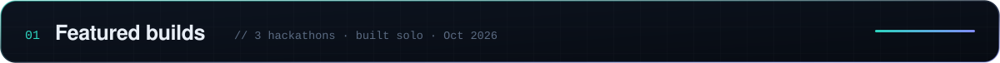
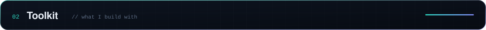
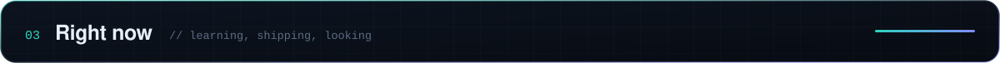
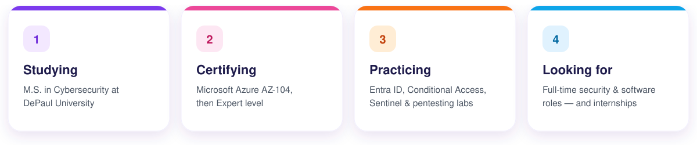

  

  
  &nbsp;
  
  &nbsp;
  

 

  
  
  

 

  <b>Languages & frameworks</b>  
  

  <b>Cloud & security</b>  
  

  <b>Design & workflow</b>  
  

  <b>Microsoft security</b>  
  
  
  
  
  
  
  
  
  

  
  
  
  

 

 

<b>A little more about me</b>

 

I started out in front-end development at **Fleetio** and web design at **National Louis University**, and was a
**Google Digital Marketing Apprentice**. Today I'm studying for my **M.S. in Cybersecurity at DePaul**
(I hold a B.S. in Computer Science & Information Systems).

Building interfaces taught me to care about the person on the other side of the screen. Security is how I look after them.
I'm happiest when I can turn a complicated idea into something simple and intuitive.

My hands-on security work spans **Azure, identity & access (Entra ID, Conditional Access), Microsoft Sentinel, Kali Linux, Terraform and DevSecOps**.

Thanks for stopping by ✨

