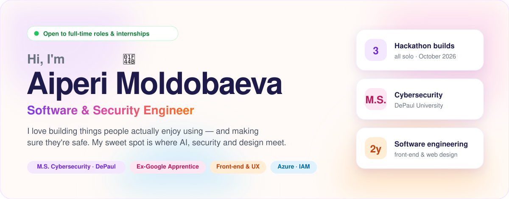
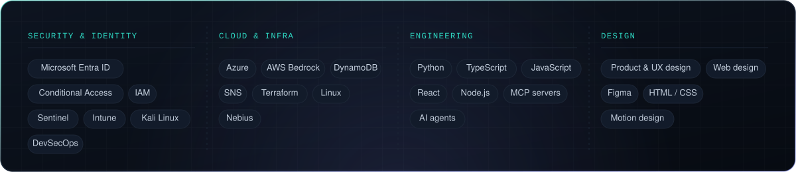

  

  
  

 

  
  
  

 

 

 

<b>About me</b> — the longer version

 

I started in front-end development at **Fleetio** and web design at **National Louis University**, and I'm now a
**Google Digital Marketing Apprentice** while studying for my **M.S. in Cybersecurity at DePaul**
(B.S. in Computer Science & Information Systems).

Building interfaces taught me to care about the person on the other side of the screen. Security is how I protect them.
My favorite work sits where **AI, security and good UX** meet: tools that are powerful underneath and simple on top.

Alongside my degree I'm training at **Cybervault School** in Azure, IAM, Sentinel, Kali Linux, Terraform and DevSecOps.

secure by design · simple by default

